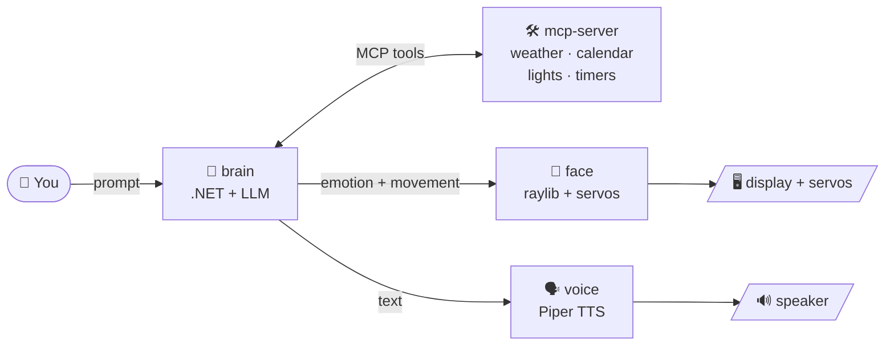

<div align="center">


# 🦉 Blinky

**A talking, emoting desk robot powered by an LLM.**<br>
An animated owl face, servo-driven head movement and a synthesised voice, all running on a Raspberry Pi 5.

[](https://github.com/petefield/face/actions/workflows/brain-image.yml)
[](https://github.com/petefield/face/actions/workflows/face-image.yml)
[](https://github.com/petefield/face/actions/workflows/mouth-image.yml)


</div>

---

## ✨ What is Blinky?

Blinky is a small robot with a personality. A prompt goes to an LLM, which works out what to say and
how it feels about it, and Blinky answers out loud while its face and head move to match.

- 🧠 **Thinks** with any OpenAI-compatible model (OpenAI or a local Ollama), keeping short-term
  conversation history and a customisable personality.
- 👀 **Shows emotion** with an animated owl face: neutral, happy, angry and sleepy, with blinking
  and eye movement.
- 🗣️ **Speaks** using [Piper](https://github.com/rhasspy/piper) text-to-speech played through ALSA.
- 🤖 **Moves** its head with servos driven by a PCA9685 board.
- 🛠️ **Does useful things** through tools: weather, calendar, lights (Home Assistant), timers and
  the current time.

## 🧩 How it fits together



| Part | Folder | Role | Runs as |
|------|--------|------|---------|
| 🧠 **brain** | [brain/](brain) | .NET 10 API. Sends your prompt to the LLM, picks an emotion, calls tools, then triggers the face and voice. | container `blinky-brain` |
| 👀 **face** | [face/](face) | Draws the owl with raylib straight to the display over DRM/KMS and moves the servos. HTTP API on port 5000. | container `blinky-face` |
| 🗣️ **voice** | [mouth/](mouth) | Piper text-to-speech behind a small FastAPI service, played out through ALSA. | container `blinky-voice` |
| 🛠️ **mcp-server** | [mcp-server/](mcp-server) | MCP server exposing the skills (calendar, lights, weather, time, timers, music, face) that the brain can call. | separate project |
| 👂 **ears** | [ears/](ears) | A command-line chat console. | run on demand |
| 🧱 **body** | [body/](body) | G-code and STL files for the 3D-printed enclosure. | n/a |

## 🎭 The face

| Neutral | Happy | Angry | Sleep |
|:---:|:---:|:---:|:---:|
|  |  |  |  |

Each expression has an open-eyed and a blink frame. Set the emotion by hand with:

```sh
curl -X POST http://<pi-host>:5000/emotion/happy
```

## 💬 Talking to Blinky

Call the brain directly:

```sh
curl -X POST http://<pi-host>:5233/prompt \
  -H 'Content-Type: application/json' \
  -d '{"prompt": "Good morning! What is the weather like today?"}'
```

---

# 🚀 Build and deploy

Everything runs on a **Raspberry Pi 5** (64-bit Raspberry Pi OS) with Docker. The container images
are built for arm64 in GitHub Actions and pulled by the Pi, so nothing is compiled on the Pi itself.

## 📋 Requirements

- Raspberry Pi 5 with Docker and Docker Compose
- A display connected to the Pi, with **no desktop or display manager running**, because the face
  draws directly to the screen
- A PCA9685 servo board on I²C bus 1 (`/dev/i2c-1`)
- A speaker or audio output that ALSA can use
- A Docker Hub account, plus an OpenAI API key or a local Ollama server

## 🔐 1. Configure

Copy [brain/.env.example](brain/.env.example) to `.env` next to `docker-compose.yml` on the Pi and
fill it in. The `.env` file is gitignored.

| Variable | Purpose |
|----------|---------|
| `DOCKERHUB_USERNAME` | Docker Hub account the images are pulled from (required) |
| `OPENAI_API_KEY`, `OPENAI_MODEL`, `OPENAI_ENDPOINT` | LLM settings (`OPENAI_ENDPOINT` is for Ollama and other compatible servers) |
| `SPEECH_URL` | Voice service address (defaults to `http://voice:5000/speak`) |
| `FACE_URL` | Face address (defaults to `http://face:5000`) |
| `HOMEASSISTANT_URL`, `HOMEASSISTANT_TOKEN` | Lights skill |
| `GOOGLE_CALENDAR_ID`, `GOOGLE_KEY_FILE` | Calendar skill |
| `XWEATHER_CLIENT_ID`, `XWEATHER_CLIENT_SECRET`, `XWEATHER_DEFAULT_LOCATION` | Weather skill |

The Piper voice model is **not in git**. Put it in `~/blinky/mouth/voices/` on the Pi (it is mounted
into the voice container).

## 📦 2. Build (GitHub Actions)

Each service has a workflow that builds natively on an arm64 runner and pushes to Docker Hub. They run
on pushes to `main` that touch the service, and can be started manually.

| Image | Workflow | Triggered by changes to |
|-------|----------|-------------------------|
| `<user>/blinky-brain` | [brain-image.yml](.github/workflows/brain-image.yml) | `brain/src/`, `brain/Dockerfile` |
| `<user>/blinky-face` | [face-image.yml](.github/workflows/face-image.yml) | `face/src/`, `face/Dockerfile` |
| `<user>/blinky-voice` | [mouth-image.yml](.github/workflows/mouth-image.yml) | `mouth/app.py`, `mouth/Dockerfile` |

The workflows need the repository secrets `DOCKERHUB_USERNAME` and `DOCKERHUB_TOKEN`.

> 💡 The face image compiles raylib 6.0 with `PLATFORM_DRM`, because `raylib-cs` ships no Linux arm64
> library. The first build takes a while. Later builds reuse the GitHub Actions layer cache.

## 🛰️ 3. Deploy to the Pi

```sh
# copy the compose file
scp docker-compose.yml pi@<pi-host>:blinky/

# pull the latest images and (re)start everything
ssh pi@<pi-host> 'cd ~/blinky && docker compose pull && docker compose up -d'
```

To update one service, name it: `docker compose pull face && docker compose up -d face`
(`brain`, `face` or `voice`). If your Docker Hub repos are private, run `docker login` on the Pi first.

Check that it is alive:

```sh
curl http://<pi-host>:5000/health      # face -> "ok"
docker compose ps                      # face shows (healthy)
docker logs -f blinky-face
```

## ⚙️ Hardware notes

- The face container gets `/dev/dri` and `/dev/i2c-1`, plus the `video`, `render` and `i2c` groups by
  numeric gid. If your Pi's gids differ, update `group_add` in [docker-compose.yml](docker-compose.yml)
  (`getent group video render i2c`).
- Servo angles are stored in the `face-data` volume, so they survive restarts.
- All containers use `restart: unless-stopped`, so Blinky comes back by itself after a reboot.
- The face API has **no authentication**. Keep it on a trusted network.

## 🏗️ Building on the Pi instead

This is slow (10-20 minutes for the first face build, and a few GB of disk), but it works without GitHub
Actions. Copy `face/Dockerfile`, `face/.dockerignore` and `face/src` (without `bin/` and `obj/`) to
`~/blinky/face/` and run:

```sh
docker compose build face
```

The same applies to `voice` with `mouth/`. Docker's build cache can use a lot of space on a small SD
card, so clean it with `docker builder prune -f` afterwards.
